# From research to automated evaluation: the Benford example

> **Audience**: researchers (and research agents) who will produce an artifact, and anyone who
> wants to evaluate one automatically with [AEBench](https://github.com/AEBench/AEBench).
> **Source of truth for**: how the pieces connect, and the commands to run the Benford example.
> The formats themselves are defined in [`SPEC.md`](https://github.com/microsoft/universal-artifact-sdk/blob/e2e/benford-aebench/SPEC.md), the
> [Artifact Reader spec](https://github.com/microsoft/universal-artifact-sdk/blob/e2e/benford-aebench/docs/artifact-reader-spec/README.md) and the
> [AEBench writer spec](https://github.com/microsoft/universal-artifact-sdk/blob/e2e/benford-aebench/docs/aebench-writer-spec/README.md).
>
> **Status (2026-11-20)**: the example ([artifact](artifact) and
> [AEBench case](aebench-case)) is on the SDK's `main`
> (microsoft/universal-artifact-sdk#92). The Artifact Reader spec, the AEBench writer spec, and the
> SPEC.md additions the example uses (`artifact_kind`, `implementation`, `output_path`,
> `volatile`) are on the SDK branch `e2e/benford-aebench`, not yet merged; the links above point
> there.

A paper says "the first-digit MAD is 0.0073". To check that automatically, a tool has to know
which script produced that number, from which data file, into which output file, and which claim
the number supports. Those facts are known exactly while the research is being done, and are
mostly lost by the time the paper is written. The pipeline below keeps them: the researcher
records them as they go, and every later step (validation, reproduction by an agent, grading)
reads them instead of guessing.

## 1. Where it starts: the SDK during research

The [Universal Artifact SDK](https://github.com/microsoft/universal-artifact-sdk) is a small library (Python and npm) that the researcher's
scripts — or an AI research agent — call **while the research is happening**, at four moments:

| Moment in the research | SDK call | Benford example |
|------------------------|----------|-----------------|
| You pick the input data | `add_dataset` | World Bank population CSV, pinned by URL and SHA-256 |
| You run an experiment | `add_experiment` | `python scripts/analyze_benford.py`, reading `data/population.csv` |
| The experiment writes an output | `add_result` | `results/summary.json` (holds the MAD), supporting claim C3 |
| You state a finding in the paper | `add_claim` | C3: "first digits conform acceptably to Benford's Law" |

In code (tested against the SDK's Python binding):

```python
from universal_artifact_sdk import (
    Claim, DataUse, Dataset, Experiment, Result, RunSpec,
    add_claim, add_dataset, add_experiment, add_result, create_artifact, write_submission,
)

a = create_artifact(id="benford-world-bank-population",
                    title="Empirical Validation of Benford's Law on Checksum-Verified World Bank Population Data")

# 1. Before analysis: pin the input data (where it lives, its hash, its license).
add_dataset(a, Dataset(id="wb-population", location={
    "kind": "external",
    "uri": "https://raw.githubusercontent.com/datasets/population/425fc447a53a26c767a15a7de60c4cc2478a0595/data/population.csv",
    "sha256": "7d2dd6a17f5ed7916de1f89a9c116791e64d207f2e2f6ce47c57e1ab46f0088a",
    "access": "public", "license": "ODC-PDDL-1.0"}))

# 2. When an experiment runs: record the exact command and the data it used.
add_experiment(a, Experiment(
    slug="primary-first-digit-benford-conformity-analysis",
    directory="experiments/primary-first-digit-benford-conformity-analysis",
    run=RunSpec(command="python scripts/validate_provenance.py && python scripts/analyze_benford.py",
                entrypoint="scripts/analyze_benford.py"),
    uses_data=[DataUse(dataset="wb-population", at="data/population.csv")]))

# 3. When it produces output: record the file and which claim it supports.
add_result(a, Result(id="R3", produced_by="primary-first-digit-benford-conformity-analysis",
                     validates=["C3"], evidence="results/summary.json", kind="metrics"))

# 4. When writing the paper: state the claim, linked to the experiment that tests it.
add_claim(a, Claim(id="C3",
    statement="First digits of the population data conform acceptably to Benford's Law (MAD < 0.012).",
    tested_by=["primary-first-digit-benford-conformity-analysis"]))

write_submission(a, "submission", stage_from=".")
```

`write_submission` turns these records into an **artifact**: a directory with `manifest.yml`
(experiments and how to run them), `datasets.yml`, `results.yml`, `claims.yml`, the evidence
files, and `SHA256SUMS`. Every link is explicit: claim C3 → result R3 → file
`results/summary.json` → experiment that wrote it → command and data. `validate_structure` checks
that these links are complete before anything is shared.

**Two forms of artifact.** The research run produces a *full artifact*: the actual code plus its
outputs. Benford was produced this way by an AI research agent: 23 experiments, their Python
scripts, and their results. For publication it was turned into a *spec artifact*
(`artifact_kind: spec-artifact`): each script was replaced by a specification (`specs/*.md`) that
states exactly what the code must compute and which files it must write, the data by a download
recipe (`DATA.md`), and the original outputs were kept as `reference-outputs/`. A spec artifact
tests whether the research can be **re-derived from its description**, not just re-run. The
evaluation pipeline handles both forms.

## 2. How the components connect

```mermaid
flowchart LR
    subgraph RES["1 · During research"]
        P["Researcher or<br/>research agent<br/>runs experiments,<br/>writes the paper"]
        B["SDK<br/>(Python / npm)<br/>add_dataset, add_experiment,<br/>add_result, add_claim"]
        A[("Artifact<br/>paper, claims, results,<br/>datasets, code or specs,<br/>outputs")]
    end
    subgraph PREP["2 · Preparing the evaluation"]
        R["Artifact Reader<br/>opens it read-only,<br/>classifies it"]
        W["AEBench writer<br/>artifact → AEBench case"]
        C[("AEBench case<br/>task for the agent +<br/>oracle + reference values")]
    end
    subgraph AEB["3 · AEBench"]
        RUN["case run<br/>an agent reproduces<br/>the work in a container"]
        O["case oracle<br/>re-runs and compares<br/>→ score 0–4"]
    end
    E[("evaluation record<br/>score tied to the exact<br/>artifact version")]

    P -- "records facts<br/>as it works" --> B
    B -- "write_submission" --> A
    A --> R
    R --> W
    W -- "generates" --> C
    C -- "task view<br/>(answers withheld)" --> RUN
    RUN -- "agent's workspace" --> O
    C -- "reference values" --> O
    O --> E
```



| Component | What it does | In the Benford example |
|-----------|--------------|------------------------|
| **SDK** | Called during research to record datasets, experiments, results and claims; writes and checks the artifact. | `validate_structure` reports 0 errors, 0 warnings. |
| **Artifact** | A directory: the paper, its claims, the results that back each claim, how to get the data, and how to reproduce each result. | 23 experiments, each a spec (`specs/*.md`); data via `DATA.md`; original outputs in `reference-outputs/`. |
| **Artifact Reader** (spec) | Opens any artifact read-only, tolerates common mistakes with warnings, rejects only if nothing is evaluable, and classifies it. | Kind `spec-artifact`: "implement these specs, then run them". |
| **AEBench writer** (spec) | Turns the artifact into an AEBench case: the task the agent sees, the oracle checks, and the reference values. | Withholds 16 output files from the agent; compares 18 of 23 results automatically. |
| **AEBench case** | `case.toml` + `artifact/` (task view + `AEBENCH_TASK.md`) + `oracles/` + `refs/`. | Case id `uas_benford_population`. Already generated and committed. |
| **`aebench case run`** | Gives the task view to an agent inside AEBench's Docker image, then runs the oracle. | The agent must implement the specs, download the data, and run the experiments. |
| **`aebench case oracle`** | Grades a workspace in 4 phases (§3). Usable on its own to audit a case. | 4/4 on a spec-only implementation; 1/4 on the untouched task view. |
| **Evaluation record** | Ties a score to the exact artifact bytes (content digest), so a score is never attached to the wrong version. | `aebench-case/evaluation-record.template.yml`, artifact block pre-filled. |

The Artifact Reader and AEBench writer are specifications; any tool can implement them. Only
someone preparing a **new** case needs a writer; the Benford case is already generated.

## 3. How a score is earned

| Phase | Checks | Benford example |
|-------|--------|-----------------|
| `env_setup` | The environment works. | `python3` is 3.10 or newer. |
| `artifact_build` | Each experiment's entry script exists and its specified tests pass. | `scripts/analyze_benford.py` exists; `python tests/test_digits.py` exits 0. |
| `benchmark_prep` | Each dataset is in place with the right hash. | `data/population.csv` has SHA-256 `7d2dd6a1…088a`. |
| `experiment_runs` | Deletes the withheld outputs, re-runs every experiment in a clean copy, and compares the regenerated numbers with the reference values. | `results/summary.json` → `/first_digit/mad` must equal 0.007314647983807111 (within 1e-9). |

Because the last phase re-runs everything, an agent that copies numbers out of the paper fails it.
Values that legitimately change on every run (timings, PDF hashes) are declared `volatile` in
`results.yml` and are not compared. This is also why §1 matters: the oracle can only compare
`/first_digit/mad` because the artifact records that R3's evidence is `results/summary.json`,
written by a known command from a known data file.

## 4. Processing the Benford example

### 4.1 Prerequisites

- Linux with Docker (for a full `aebench case run`), Python ≥ 3.10, and [`uv`](https://docs.astral.sh/uv/).
- Network access to `raw.githubusercontent.com` (the agent downloads the data).
- An agent login for AEBench (Codex or Claude subscription; see the AEBench README).

```bash
git clone https://github.com/microsoft/universal-artifact-sdk.git
git clone https://github.com/AEBench/AEBench.git
cd AEBench && uv sync && cd ..
```

### 4.2 Look at the artifact (2 minutes)

```bash
cd universal-artifact-sdk/examples/benford-e2e/artifact
grep artifact_kind manifest.yml          # artifact_kind: spec-artifact
ls specs/                                # one spec per script, e.g. analyze_benford.md
sed -n 1,30p DATA.md                     # download URL + SHA-256 of the one input file
```

### 4.3 Check the artifact with the SDK (optional)

```bash
cd universal-artifact-sdk
python -m pip install -e .
python -c "
from universal_artifact_sdk import open_submission, validate_structure
r = validate_structure(open_submission('examples/benford-e2e/artifact'))
print(len(r.errors), 'errors,', len(r.warnings), 'warnings')"
# expected: 0 errors, 0 warnings
```

### 4.4 (Only for a different artifact) generate a case

The Benford case is already in `examples/benford-e2e/aebench-case/`, so skip this step. For a new
artifact, implement the [AEBench writer spec](https://github.com/microsoft/universal-artifact-sdk/blob/e2e/benford-aebench/docs/aebench-writer-spec/README.md) (it
reads the artifact as the [Artifact Reader spec](https://github.com/microsoft/universal-artifact-sdk/blob/e2e/benford-aebench/docs/artifact-reader-spec/README.md)
describes) and run it with a case id and the paper's URL. The implementation used for Benford
was built from the spec text alone and is not shipped.

### 4.5 Register the case in AEBench

```bash
cp -r universal-artifact-sdk/examples/benford-e2e/aebench-case AEBench/cases/uas_benford_population
cd AEBench
python3 - <<'EOF'
import json
p = "cases.json"; d = json.load(open(p))
d["cases"]["uas_benford_population"] = {"path": "cases/uas_benford_population"}
json.dump(d, open(p, "w"), indent=2); open(p, "a").write("\n")
EOF
PYTHONPATH=src uv run aebench case validate uas_benford_population
# expected: Case bundle is valid
```

### 4.6 Run an agent on it

```bash
uv run aebench agent list                       # available harnesses
uv run aebench case run uas_benford_population \
  --agent claude_non_api --model <model>        # or --agent codex_non_api
```

The agent sees `AEBENCH_TASK.md`: the claims to reproduce, "implement each specification",
where to download the data, and the list of withheld paths. The agent's time budget is 4 hours.

### 4.7 Grade a workspace directly (audit, no agent)

To grade a workspace that someone implemented by hand, run the oracle in the environment where
that implementation's packages are installed (it runs the experiments' `python` commands):

```bash
cd AEBench
PATH=/path/to/workspace/.venv/bin:$PATH PYTHONPATH=src .venv/bin/aebench case oracle \
  uas_benford_population \
  --workspace-dir /path/to/workspace --output-dir /tmp/benford-oracle
```

Use `.venv/bin/aebench` rather than `uv run` here: `uv run` puts AEBench's own Python first on
`PATH`, and the experiments then fail to import numpy and scipy.

### 4.8 Read the result

| Where | What |
|-------|------|
| AEBench's output (`Score: 4/4`) | One point per passing phase. |
| `<output-dir>/aebench-writer-checks.jsonl` | Every individual check, e.g. `{"phase": "experiment_runs", "check": "result:R3", "ok": true, ...}`; a failure lists up to 10 `<key>: observed <x>, reference <y>` mismatches. |
| `cases/uas_benford_population/WRITER-NOTES.md` | What is **not** graded automatically: R2, R11, R15, R17 and R19 (only written reports as evidence). |
| `evaluation-record.template.yml` | Copy to the run's output as `evaluation-record.yml` and fill in `config` and `outcome`. |

Expected outcomes: a correct implementation scores **4/4** (90 of 90 checks); the untouched task
view scores **1/4** (only `env_setup` passes).
